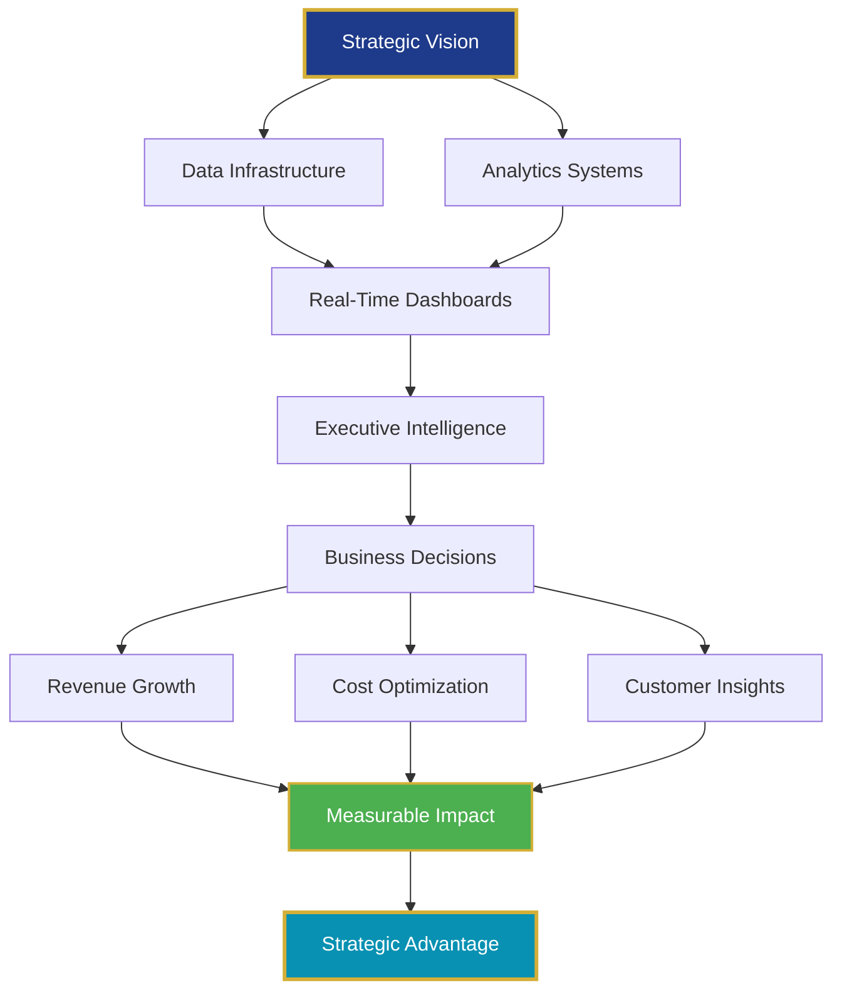
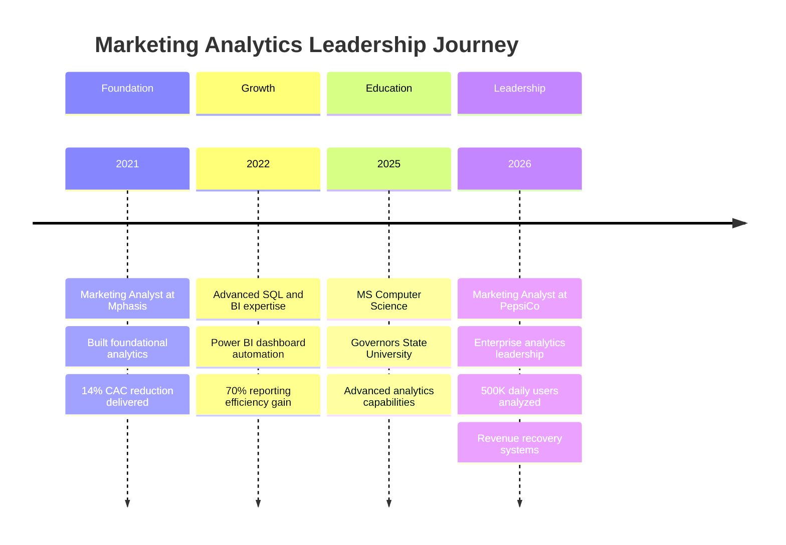
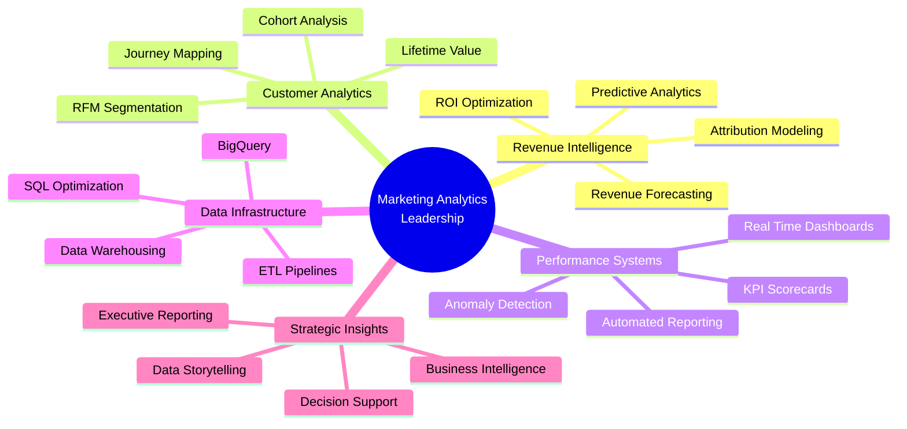
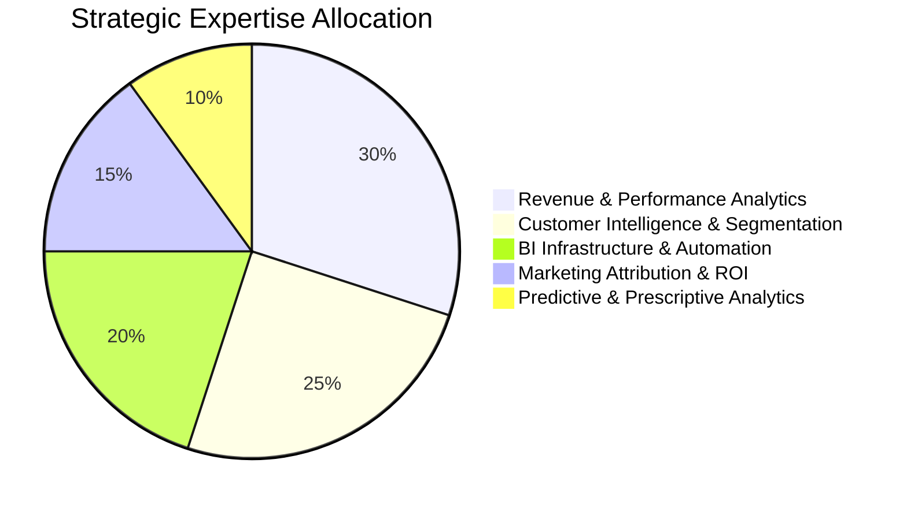

---

## 📊 Executive Performance Dashboard

| **Leadership Metric** | **Impact Delivered** | **Strategic Value** |
|:---:|:---:|:---:|
| **Revenue Optimization** | $500K+ Annual Impact | CAC Reduction & Revenue Recovery |
| **Team Enablement** | 8 Executives Served | Self-Service Analytics @ Scale |
| **Operational Efficiency** | 70-90% Time Savings | Automated Reporting Systems |
| **Data-Driven Decisions** | 500K+ Daily Users Analyzed | Real-Time Performance Intelligence |
| **Customer Intelligence** | 6,500+ Customers Segmented | 49% Revenue from Top Segments |
| **Career Trajectory** | 2+ Years Analytics Leadership | PepsiCo & Mphasis |

---

## 🎯 Executive Summary

**Transforming Marketing Performance Through Strategic Analytics Leadership**

Results-driven Marketing Analytics Leader with proven expertise in delivering measurable business impact through data-driven decision-making at Fortune 500 organizations. Currently driving marketing intelligence initiatives at **PepsiCo**, where I architect enterprise-scale analytics solutions that process 500,000+ daily active users and generate actionable insights enabling $500K+ in annual revenue optimization.

My leadership philosophy centers on **converting complex data into executive-ready strategic intelligence** that drives immediate business value. I specialize in building scalable analytics infrastructure, automating decision-support systems, and empowering cross-functional teams with self-service insights that accelerate time-to-action from hours to minutes.

**Core Leadership Competencies:**
- **Revenue Impact Engineering**: Designed predictive revenue systems that recovered $180K through proactive budget rebalancing
- **Analytics Infrastructure**: Built automated anomaly detection reducing incident response from 4 hours to 15 minutes
- **Strategic Insights Delivery**: Identified high-value customer segments generating 49% of total revenue through RFM modeling
- **Operational Excellence**: Eliminated 90-minute manual reporting processes, freeing 7+ hours weekly for strategic analysis
- **Cross-Functional Leadership**: Partnered with 8+ executives to deliver real-time performance intelligence enabling data-driven marketing optimization

---

## 💼 Leadership Philosophy

> **"Strategic analytics leadership isn't about generating reports—it's about engineering decision-making systems that transform data into competitive advantage at enterprise scale."**

I lead with a **business-first, technology-second** approach, focusing on three core principles:

1. **Impact Over Activity**: Every analytics initiative must tie directly to revenue growth, cost reduction, or strategic decision acceleration
2. **Empowerment Through Automation**: Build self-service systems that enable teams to answer their own questions, freeing analysts for strategic work
3. **Proactive Intelligence**: Move from reactive reporting to predictive systems that flag opportunities and risks before they impact the business

My leadership style emphasizes **stakeholder partnership**, **rapid iteration**, and **measurable outcomes**—ensuring analytics investments deliver quantifiable ROI and strategic business value.

---

## 🚀 Strategic Impact Architecture

---

## 📈 Career Progression Timeline

---

## 🏆 Key Strategic Achievements

### **PepsiCo - Marketing Analytics Leadership** (Feb 2026 - Present)

#### **Revenue Intelligence & Recovery Systems**
- **$180K Revenue Recovery**: Engineered predictive revenue dashboard calculating daily run-rate projections versus monthly targets, flagging 3-day advance warnings when pacing would miss forecast by 5%+, enabling real-time budget rebalancing that recovered $180,000 in at-risk revenue
- **$320K Email Budget Optimization**: Analyzed 6-month cross-channel dataset revealing email-sourced users demonstrated 4.1x higher repeat purchase rate versus paid search, informing strategic email budget increase of $320K annually based on quantified customer lifetime value analysis
- **16% CPA Reduction**: Created drill-down campaign performance analysis identifying 3 underperforming Google Ads campaigns with CPA 28% above target, prompting keyword pruning and bid adjustments yielding 16% cost-per-acquisition improvement

#### **Enterprise Analytics Infrastructure**
- **500K Daily User Intelligence**: Architected live GA4 and BigQuery dashboard processing 500,000 daily active users with 5-minute refresh rate, tracking revenue, conversion funnel performance, and multi-touch attribution across 12 traffic sources
- **15-Minute Incident Response**: Engineered automated anomaly detection system flagging traffic drops exceeding 15% or conversion spikes exceeding 25% per channel within 5 minutes, reducing incident response time from 4 hours to 15 minutes and enabling faster paid media budget reallocation
- **7 Hours Weekly Efficiency Gain**: Automated daily performance report delivery to 8 executives via Looker Studio with PDF exports, replacing 90-minute manual Excel reporting with 10-minute automated refresh, freeing 7 hours per week for strategic analysis

#### **Customer Intelligence & Segmentation**
- **18% Incremental Mobile Revenue**: Implemented breakdown analysis by device, geography, and audience segment, revealing iOS users converted at 2.3x rate of Android users, recommending iOS-focused paid social budget shift with projected 18% incremental mobile revenue
- **62% Mobile Traffic Optimization**: Identified mobile traffic represented 62% of volume but only 34% of revenue, directing optimization efforts to high-intent segments and informing platform-specific conversion rate optimization initiatives

---

### **Mphasis - Marketing Analytics Foundation** (Mar 2021 - Jul 2022)

#### **Marketing Performance Optimization**
- **14% CAC Reduction**: Analyzed marketing performance across Google Ads, Meta Ads, LinkedIn Ads, and Email using SQL, Excel, and Power BI, identifying channel optimization opportunities that reduced Customer Acquisition Cost by 14% while improving qualified lead generation by 17%
- **11% Conversion Rate Improvement**: Conducted marketing funnel analysis across website visits, lead forms, MQLs, SQLs, and conversions, identifying 42% drop-off between MQL and SQL stages and recommending lead nurturing workflows projected to increase conversion rates by 11%

#### **Customer Intelligence & Segmentation**
- **49% Revenue from Top Segments**: Developed RFM customer segmentation models using SQL for 6,500+ customer records, identifying high-value customer segments that generated 49% of total revenue and supporting targeted retention campaigns
- **16% Engagement Improvement**: Performed cohort retention analysis using SQL and Excel across 12 monthly cohorts, identifying engagement trends and recommending targeted campaigns that improved repeat customer engagement by 16%

#### **Analytics Infrastructure & Automation**
- **70% Reporting Efficiency**: Built interactive Power BI dashboards tracking ROAS, CAC, CPL, CTR, Conversion Rate, and CLV, reducing manual reporting by 70% and enabling self-service analytics for cross-functional teams
- **80% Time Savings**: Automated campaign performance reporting using SQL and Power Query, reducing report generation time from 5 hours to under 1 hour while improving reporting accuracy and data freshness

---

## 🧠 Strategic Expertise Landscape

---

## 🛠️ Executive Technology Stack

### **Analytics & Intelligence Platforms**

### **Data Engineering & Analysis**

### **Marketing Intelligence**

---

## 💡 Core Competency Distribution

---

## 🎯 Featured Strategic Initiatives

### **1. Enterprise Revenue Intelligence Platform (PepsiCo)**

**Business Challenge**: Executive leadership lacked real-time visibility into revenue performance versus targets, resulting in reactive budget decisions and missed revenue opportunities.

**Strategic Solution**: Architected predictive revenue dashboard integrating GA4, BigQuery, and Looker Studio to calculate daily run-rate projections, forecast monthly performance, and flag at-risk revenue 3+ days in advance.

**Measurable Impact**:
- **$180K Revenue Recovery**: Enabled proactive budget rebalancing preventing revenue shortfalls
- **3-Day Early Warning System**: Flagged forecast misses when pacing deviated by 5%+
- **Executive Decision Acceleration**: Real-time intelligence enabled same-day strategic adjustments

**Technologies**: Google BigQuery, GA4, Looker Studio, SQL, Predictive Analytics

---

### **2. Automated Marketing Intelligence System (PepsiCo)**

**Business Challenge**: Marketing team spent 90 minutes daily generating manual Excel reports for 8 executives, delaying strategic analysis and limiting proactive optimization.

**Strategic Solution**: Engineered automated reporting infrastructure with Looker Studio, BigQuery, and scheduled PDF delivery, eliminating manual processes and enabling self-service analytics.

**Measurable Impact**:
- **7 Hours Weekly Efficiency**: Freed analysts for strategic work versus manual reporting
- **10-Minute Refresh Cycles**: Replaced 90-minute manual processes with automated intelligence
- **8 Executive Stakeholders**: Enabled self-service access to real-time performance data

**Technologies**: Looker Studio, Google BigQuery, SQL, Power Query, Automation Workflows

---

### **3. Customer Lifetime Value Optimization (Mphasis)**

**Business Challenge**: Marketing budget allocated uniformly across channels without customer value intelligence, resulting in inefficient acquisition spending and suboptimal ROAS.

**Strategic Solution**: Developed RFM segmentation models analyzing 6,500+ customer records to identify high-value segments, inform retention strategies, and optimize acquisition targeting.

**Measurable Impact**:
- **49% Revenue Concentration**: Identified top customer segments generating nearly half of total revenue
- **14% CAC Reduction**: Optimized channel mix based on customer value intelligence
- **17% Lead Quality Improvement**: Enhanced targeting based on high-value customer profiles

**Technologies**: SQL, Excel, Power BI, RFM Modeling, Customer Segmentation

---

### **4. Real-Time Anomaly Detection Engine (PepsiCo)**

**Business Challenge**: Marketing performance issues (traffic drops, conversion anomalies) discovered hours after occurrence, limiting ability to respond and minimize revenue impact.

**Strategic Solution**: Built automated anomaly detection system monitoring 12 traffic sources with 5-minute refresh rate, flagging deviations exceeding 15% (traffic) or 25% (conversions) and triggering immediate alerts.

**Measurable Impact**:
- **15-Minute Response Time**: Reduced incident detection from 4 hours to 15 minutes
- **Proactive Budget Reallocation**: Enabled real-time paid media adjustments
- **Revenue Protection**: Minimized impact of performance anomalies through rapid response

**Technologies**: Google BigQuery, GA4, SQL, Automated Alerting, Real-Time Analytics

---

## 📚 Professional Development & Education

| **Degree** | **Institution** | **Specialization** | **Completion** |
|:---:|:---:|:---:|:---:|
| **Master of Science** | Governors State University | Computer Science | Dec 2025 |
| **B.Tech** | JNTU Hyderabad | Computer Science & Engineering | Sep 2023 |

**Strategic Value**: Advanced computer science education provides deep technical foundation enabling sophisticated analytics infrastructure design, algorithm development for predictive modeling, and scalable data engineering solutions supporting enterprise-scale marketing intelligence.

---